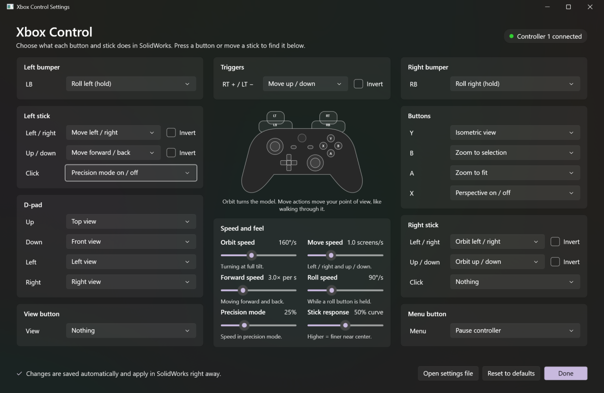
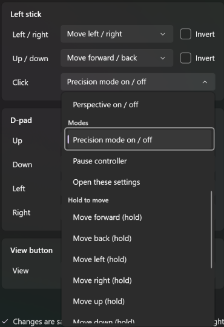

# Xbox Control for SolidWorks

Move around SOLIDWORKS models with an Xbox controller. Orbit, walk forward, strafe, rise, roll
and zoom at the same time, with analog speed, and remap every button and stick in a modern
settings app.

<br clear="left" />



## Features

- **Drives the SolidWorks view directly** through the SolidWorks API from inside SolidWorks: no
  keystrokes, no focus tricks, no keys getting "stuck" or doing the opposite of what you expect.
- **Every axis at once, analog.** Push a stick a little to creep, all the way to move fast.
- **Walk-through style by default:** left stick moves you forward/back and sideways, triggers
  move you up/down, right stick orbits.
- **Remap anything** in the settings app. Press a button on the controller and its setting
  lights up, so you always know which one you're changing. Changes apply instantly.
- **Quick views:** zoom to fit, zoom to selection, isometric/front/top/left/right/back/bottom,
  perspective on/off.
- **Precision mode** for fine positioning, and **pause** so the controller can sit on the desk.
- Only acts while SolidWorks is the active window. Shows its state in the SolidWorks status bar.

## Install

1. Download **`XboxControl-1.0.0.msi`** from the [latest release](https://github.com/kevinoue/Xbox-Control/releases/latest).
2. Run it and click **Install**. It installs for your Windows account only; no administrator
   rights needed.
3. Restart SolidWorks.

That's it: SolidWorks loads the add-in at startup, and the status bar shows
*"Xbox controller 1: ready"* once the controller is on.

> Windows may show *"Windows protected your PC"* because the installer isn't code-signed yet.
> Click **More info**, then **Run anyway**.

**Requirements:** Windows 10 or 11 (64-bit), SOLIDWORKS 2023 or newer (tested on 2023 SP5), and an
Xbox One / Series controller (USB, Bluetooth or wireless adapter) or any other XInput controller.

**Uninstall:** Windows Settings > Apps > *Xbox Control for SolidWorks*.

## Default controls

| Controller | Action |
|---|---|
| Left stick up / down | Move forward / back |
| Left stick left / right | Move left / right |
| Right stick | Orbit (the model follows the stick) |
| RT / LT | Move up / down |
| LB / RB | Roll left / right |
| A | Zoom to fit |
| B | Zoom to selection (click a part or face first) |
| X | Perspective on / off |
| Y | Isometric view |
| D-pad up / down / left / right | Top / Front / Left / Right view |
| Left stick click | Precision mode (slow) on / off |
| Menu | Pause / resume the controller |
| View, right stick click | Not assigned |

Moving forward zooms toward the middle of the screen, so aim at what you want first. With
perspective on (X) it feels more like walking in.

## Change the controls

Open **Xbox Control Settings** from the Start menu, or in SolidWorks from **Tools > Xbox Control
Settings...**.



- Each button can do a one-press action (a view, zoom to fit, perspective, precision, pause,
  open the settings) or a **hold** action that keeps moving while it's held (move, orbit, roll).
- Each stick direction and the triggers can do any movement, with an **Invert** box to flip it.
- **Speed and feel:** orbit, move, forward and roll speeds, precision-mode speed, and stick
  response (higher gives finer control near the center).
- Changes save automatically and SolidWorks picks them up within a second; no restart.
- **Reset to defaults** puts everything back.

The settings live in `%APPDATA%\XboxControl\addin.ini`, a plain text file you can also edit
by hand.

<br clear="right" />

## Troubleshooting

| Problem | Fix |
|---|---|
| Nothing happens, and the status bar never mentions the controller | Check **Tools > Add-ins** in SolidWorks: tick **Xbox Control** (both boxes to load it every time). If SolidWorks runs *as administrator*, Windows hides per-user add-ins from it; start SolidWorks normally. |
| Status bar says *not connected* | Turn the controller on (hold the Xbox button until it lights up). |
| Status bar says *paused* | Press Menu (or whichever button you assigned to pause). |
| The view doesn't move | SolidWorks must be the active window. Click into it once. |
| Moves the wrong way | Tick **Invert** for that stick in the settings app, or pick a different action. |

The add-in logs problems to `%LOCALAPPDATA%\XboxControl\addin.log`.

## How it works

The add-in runs inside SolidWorks and polls the controller about 60 times a second on SolidWorks'
own UI thread, then moves the view with `IModelView` (`RotateAboutCenter`, `TranslateBy`,
`ZoomByFactor`, `RollBy`) with one redraw per update. Measured on SolidWorks 2023 SP5 with a
155-part assembly:

| | From a separate program | Inside SolidWorks (this add-in) |
|---|---|---|
| Orbit + move + zoom in one update | ~35 ms (~30 updates/s) | 5.6 ms (~57 updates/s) |

The first version of this project sent the Walk-through tool's keyboard shortcuts instead. That
couldn't work reliably: the Walk-through reuses Shift and Alt for different movements, so two
movements at once turned into a third (rising while strafing became turning), and keys could
stay held after a disconnect. That keystroke app is still in the repo (`Xbox Control/`), fixed up,
for anyone who wants to drive the built-in Walk-through tool specifically.

## Build from source

Needs the .NET 10 SDK and SolidWorks installed (the projects reference its API from
`C:\Program Files\SOLIDWORKS Corp\SOLIDWORKS\api\redist`; override with `-p:SolidWorksApiDir=...`).

```powershell
dotnet build "Xbox Control.sln"
dotnet test "Xbox Control.sln"
.\tools\build-installer.ps1        # -> artifacts\XboxControl-<version>.msi
```

For development without the installer, `.\tools\register-addin.ps1` registers the Debug build
for the current user (restart SolidWorks to load a new build).

| Folder | What it is |
|---|---|
| `Xbox Control.Addin/` | The SolidWorks add-in (.NET Framework 4.8, required by SolidWorks) |
| `Xbox Control.Settings/` | Settings app (WPF on .NET 10, Windows 11 theme) |
| `Xbox Control.Tests/` | Unit tests for the navigation, mapping, settings and keystroke logic |
| `installer/` | WiX installer (per-user MSI) |
| `Xbox Control/` | The original keystroke-based Walk-through app |
| `tools/AddinDev` | Load/unload the add-in in a running SolidWorks, run its in-process self-test, simulate button presses |
| `tools/SwViewBench` | Times SolidWorks view API calls from a separate process |

## License

[CC0 1.0](LICENSE.txt): public domain. SOLIDWORKS is a trademark of Dassault Systèmes and Xbox is
a trademark of Microsoft; this project isn't affiliated with either.
